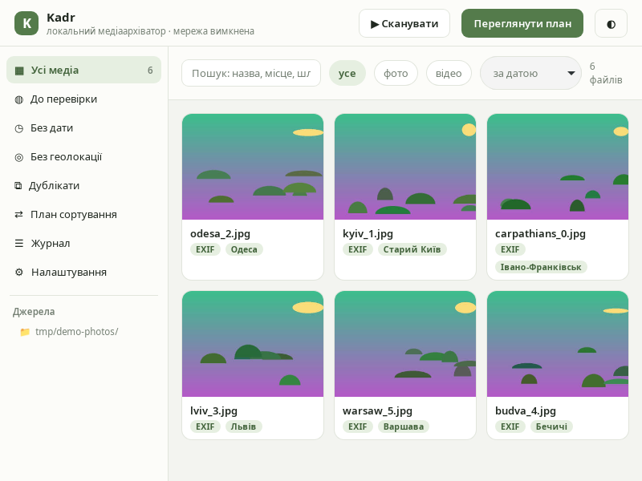
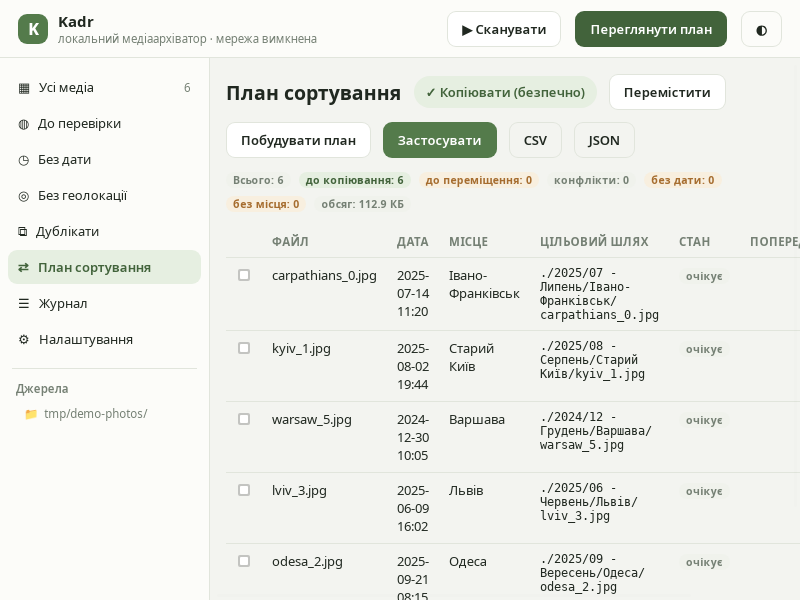

# Kadr

Локальний десктопний архіватор фото та відео: наводить лад у безладних папках, не чіпаючи оригінали без вашого дозволу.

**Принципи:** усе локально, жодних хмар і телеметрії; спочатку попередній перегляд плану — потім операція; кожна операція журналюється і скасовується.





## Що вміє

- 📷 **Сканування папок** — індексує фото/відео, читає EXIF/відео-метадані (дата зйомки, GPS, тривалість), створює мініатюри
- 🗓 **Сортування за датою зйомки**, а не за датою файлової системи; коректна робота з часовими зонами та offset з EXIF
- 🗺 **Місця зйомки** — GPS з EXIF + офлайн-геокодер за вбудованою базою GeoNames (236 тис. міст, українські назви); вручне призначення місця завжди має пріоритет
- 👀 **Планування** — повний попередній перегляд того, куди і як переміститься кожен файл, до будь-яких змін на диску
- ✅ **Виконання** — копіювання або переміщення з контрольными сумами, розв'язання конфліктів імен (суфікси/пропуск/перезапис), skip-символічні посилання
- ↩️ **Undo** — кожен прогнаний план можна відкатати; журнал операцій переживає падіння програми
- 🔍 **Медіатека** — фільтри за датами, місцями, папками; рукописні виправлення дати/місця зберігаються у власній БД, а не псують файли
- 📤 **Експорт звітів** планів у CSV/JSON

## Робота з метаданими (ExifTool / FFprobe)

Kadr використовує дві безплатні утиліти:

- [ExifTool](https://exiftool.org) — читання/запис метаданих
- FFprobe (з [FFmpeg](https://ffmpeg.org)) — метадані та мініатюри відео

**Вам нічого не треба встановлювати самому:** у Windows-інсталятори обидві утиліти вбудовані; `.deb` тягне їх як системні залежності; у macOS-збірці — через Homebrew (`brew install exiftool ffmpeg`). Програма спершу шукає вбудовані копії, потім системні; статус завжди видно в Налаштуваннях. Навіть без утиліт Kadr не падає — просто частина метаданих буде недоступна.

## Завантаження

Готові збірки — у [Releases](../../releases): Windows (`.msi`/`.exe`), Linux (`.AppImage`/`.deb`/`.rpm`), macOS (`.dmg`).

## Збірка з вихідників

Передумови: Rust (stable), Node 22+, системні залежності Tauri ([інструкція](https://tauri.app/start/prerequisites/)).

```bash
npm install
npm run tauri dev      # розробка
npm run tauri build    # релізна збірка + інсталятори
```

Тести ядра: `cargo test --workspace`; перевірка UI: `npm run check`.

## Склад проєкту

| Шлях | Призначення |
|---|---|
| `core/` | доменне ядро Rust (сканування, метадані, плани, операції, журнал, БД) |
| `src-tauri/` | Tauri-оболонка (команди, стейт, бандлинг) |
| `src/` | Svelte 5 + TypeScript UI |

## Статус

MVP: сканування, медіатека, офлайн-геокодер, планування, виконання, undo, звіти — реалізовані; тести ядра проходять на Linux/macOS/Windows у CI.

## Ліцензія

MIT — див. [LICENSE](LICENSE).
